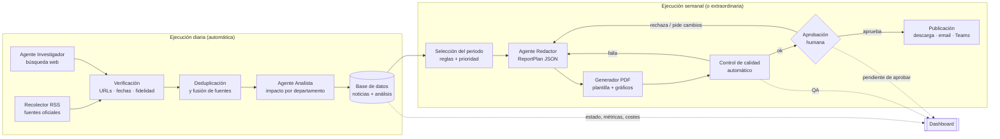
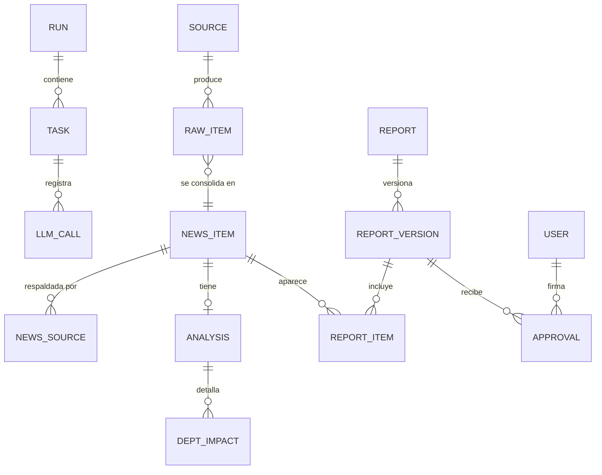

# Propuesta técnica — Sistema multiagente de noticias de IA

> Versión 0.1 · 16/10/2026 · Estado: **propuesta pendiente de validación** (todavía no hay código)
>
> Precios y nombres de modelos verificados con la documentación de la API de Claude a fecha de octubre de 2026. Se volverán a comprobar antes de implementar cada fase.

---

## 1. Qué he entendido del proyecto

Quieres un sistema que, sin intervención diaria:

1. **Investigue** cada día las novedades relevantes de IA (proveedores, modelos, herramientas, IA industrial, regulación, hardware).
2. **Verifique y depure** esa información: fuentes identificables, sin duplicados, sin rumores presentados como hechos, fechas correctas.
3. **Analice el impacto** de cada noticia para tu empresa y para 9 departamentos (Calidad, Ingeniería, IT, Finanzas, RRHH, Ventas, 3D, Logística, Gerencia), separando "interesante tecnológicamente" de "aporta valor real".
4. **Genere una presentación PDF** semanal (8-15 páginas, formato coherente entre ediciones, gráficos basados en datos reales, fuentes verificables) y, opcionalmente, versiones para dirección o por departamento.
5. **Requiera tu aprobación** antes de que nada se comparta.
6. **Muestre en un dashboard** qué hace cada agente, el estado del flujo, noticias, informes, errores, reintentos, métricas y costes, y permita lanzar ejecuciones, pausar la automatización y cambiar la configuración.

Principios que guían la propuesta:

- **IA solo donde aporta criterio** (buscar, juzgar relevancia, resumir, analizar impacto). Todo lo demás —deduplicar por URL, comprobar enlaces, fechas, calcular métricas, maquetar el PDF, programar tareas— es **código determinista**, más fiable y barato.
- **Datos estructurados entre etapas** (esquemas validados), persistidos en base de datos: cada etapa se puede reintentar sola.
- **Trazabilidad**: toda afirmación del informe apunta a una noticia, y toda noticia a URLs que realmente aparecieron en la búsqueda.
- **Coste controlado y medido** desde el primer día.

---

## 2. Arquitectura de agentes

Hay **4 componentes con IA** ("agentes") y **4 componentes deterministas**. El orquestador es código, no un LLM.

| # | Componente | Tipo | Responsabilidad | Entrada → Salida |
|---|---|---|---|---|
| 0 | **Orquestador** | Código | Ejecuta el flujo, guarda estado de cada etapa, reintentos, límites de coste, historial | Configuración → `run` + `tasks` |
| 1 | **Recolector de fuentes** | Código | Lee fuentes oficiales fijas (RSS/blogs de Anthropic, OpenAI, Google, Meta, xAI, NVIDIA, Microsoft…) | Lista de fuentes → `raw_items` |
| 2 | **Agente Investigador** | IA + búsqueda web | Descubre noticias que no están en las fuentes fijas, lee la fuente original, extrae los campos de cada noticia y propone prioridad | Temas + `raw_items` → `NewsCandidate[]` |
| 3 | **Verificador y deduplicador** | Código + IA ligera | Normaliza URLs, agrupa duplicados, comprueba enlaces y fechas, exige que cada URL citada exista en los resultados de búsqueda; un modelo ligero contrasta "resumen vs. texto original" y marca rumores | `NewsCandidate[]` → `NewsItem[]` verificados |
| 4 | **Agente Analista** | IA | Con el perfil de tu empresa, asigna departamentos, casos de uso, ahorro potencial, riesgos, herramientas a evaluar y acciones (corto/medio/largo plazo). Distingue *hecho / interpretación / recomendación* y señala qué requiere validación interna | `NewsItem[]` + perfil empresa → `Analysis[]` |
| 5 | **Agente Redactor** | IA | Selecciona y ordena las noticias del periodo y redacta los textos breves del informe (resumen ejecutivo, conclusiones, textos por departamento) en JSON, nunca en maquetación libre | Noticias + análisis del periodo → `ReportPlan` |
| 6 | **Generador de PDF** | Código | Plantilla corporativa HTML/CSS → PDF. Gráficos calculados desde la BD (nunca inventados por el modelo) | `ReportPlan` + métricas → PDF |
| 7 | **Control de calidad** | Código (+ IA opcional) | Comprueba enlaces, páginas desbordadas, imágenes, nº de páginas, que cada noticia tenga fuente, coherencia de fechas | PDF + `ReportPlan` → informe de QA |
| 8 | **Publicación** | Humano + código | Tú apruebas en el dashboard; solo entonces se distribuye (fase posterior: email/Teams/SharePoint) | Informe aprobado → entrega |

Por qué así y no "un agente autónomo que lo hace todo":

- Un único agente que busca, decide, escribe y maqueta es difícil de depurar, caro y poco reproducible.
- Con etapas separadas sabes **dónde** falló algo, puedes reintentar solo esa etapa y comparar ediciones.
- Las comprobaciones críticas (URLs reales, fechas, duplicados) no dependen del "buen comportamiento" del modelo.

---

## 3. Flujo completo



Cada caja escribe su resultado en la base de datos con un estado (`pendiente`, `ejecutando`, `completado`, `error`). Si "Agente Analista" falla, se reintenta solo esa etapa usando las noticias ya verificadas; no se repite la búsqueda.

### Formatos de datos entre agentes (borrador)

Los esquemas se definirán en Python con Pydantic y se exigirán a la API mediante *structured outputs*, de modo que la respuesta del modelo siempre cumple el formato.

`NewsCandidate` (salida del Investigador):

```json
{
  "headline": "Anthropic lanza ...",
  "published_at": "2026-10-14",
  "event_date": "2026-10-14",
  "companies": ["Anthropic"],
  "technologies": ["Claude"],
  "category": "modelos | herramientas | industria | infraestructura | regulación | seguridad | mercado",
  "what_happened": "…",
  "why_it_matters": "…",
  "executive_summary": "…(máx. 60 palabras)",
  "sources": [{"url": "https://…", "publisher": "anthropic.com", "type": "oficial | medio | análisis | rumor"}],
  "claim_status": "confirmado | anunciado | rumor",
  "proposed_priority": "crítica | alta | media | baja"
}
```

`NewsItem` = `NewsCandidate` + campos del verificador: `verification_status` (`verificada`, `parcial`, `no_verificable`), `reliability_score` (0-1, por reglas: fuente oficial, nº de fuentes independientes, antigüedad), `link_ok`, `duplicate_of`, `faithfulness_notes`.

`Analysis` (salida del Analista, una por noticia):

```json
{
  "news_id": 123,
  "relevance_for_company": "alta",
  "is_actionable": true,
  "departments": [
    {
      "department": "ingenieria",
      "use_cases": ["…"],
      "productivity_gain": "cualitativo: …",
      "risks": ["…"],
      "requirements": ["licencia empresarial", "…"],
      "tools_to_evaluate": ["…"],
      "action": {"horizon": "corto | medio | largo", "description": "…"},
      "needs_internal_validation": ["¿usamos X en el proceso Y?"]
    }
  ],
  "facts": ["…"], "interpretations": ["…"], "recommendations": ["…"]
}
```

`ReportPlan` (salida del Redactor): lista ordenada de secciones con referencias a `news_id`; el generador de PDF solo pinta lo que viene en el plan y rellena los gráficos con consultas a la BD.

---

## 4. Arquitectura tecnológica

### Opción A (recomendada para el MVP) — Pipeline propio en Python + API de Claude

| Necesidad | Elección | Motivo |
|---|---|---|
| Lenguaje | **Python 3.12** | Ecosistema de datos, PDF y gráficos; SDK oficial de Anthropic |
| Orquestación | **Código propio** (módulo `pipeline/`) con estado en BD | El flujo es lineal y conocido; no necesitamos un framework de agentes (LangGraph, CrewAI…) que añade dependencias sin aportar aquí |
| Modelos | API de Claude: **Sonnet 5.5** para investigar y analizar, **Haiku 5.5** para verificaciones ligeras, **Opus 5.5** para el redactor semanal. Configurable por agente | Equilibrio calidad/coste; el modelo de cada agente es un parámetro |
| Búsqueda | Herramientas del servidor de Claude **`web_search` + `web_fetch`** + RSS de fuentes oficiales | Sin otra API de búsqueda que contratar; RSS reduce coste y da fuentes primarias |
| Formato entre etapas | **Structured outputs** + Pydantic | Salidas siempre válidas; se rechaza lo que no cumpla |
| Base de datos | **SQLite** en el MVP (SQLModel/SQLAlchemy) → **PostgreSQL** si hay varios usuarios o servidor compartido | Cero mantenimiento al inicio; migración sin reescribir |
| PDF | **HTML + CSS (Jinja2) → WeasyPrint**, formato apaisado 16:9 | Diseño corporativo con CSS, cabeceras/pies, saltos de página controlados, reproducible |
| Gráficos | **Matplotlib → SVG** con estilo corporativo fijo | Calculados desde la BD: nº de noticias por empresa, por departamento, por prioridad, evolución semanal |
| Dashboard | **Streamlit** | Dashboard completo en Python en días, no semanas; filtros, tablas, vista previa y descarga de PDF, botones de ejecutar/reintentar/aprobar |
| Programación | **APScheduler** en un proceso *worker* | Horarios editables desde el dashboard (se guardan en BD) |
| Despliegue | **Docker Compose** (worker + dashboard + BD) en un PC/servidor de oficina o una VM pequeña | Un comando para arrancar; portable |
| Secretos | Variables de entorno / `.env` fuera de git; clave de API en un *workspace* propio de la Console de Anthropic con **límite de gasto** | La clave nunca está en el código ni en la BD |
| Costes y logs | Tabla `llm_calls` con tokens, búsquedas y coste de cada llamada; logs estructurados | Coste por ejecución, por agente y por informe en el dashboard |

**Ventajas:** control total, todo auditable, sin dependencia de plataformas beta, coste de infraestructura casi nulo, fácil de probar.
**Inconvenientes:** hay que mantener el código y el servidor; Streamlit tiene autenticación básica (suficiente para pocos usuarios, mejorable después).
**Dificultad:** media. **Dependencia de proveedor:** baja-media (los modelos se llaman desde un único módulo; cambiar de proveedor afecta a ese módulo y a la búsqueda web).

### Opción B — Claude Managed Agents (Anthropic aloja los agentes y la programación)

Anthropic ejecuta el bucle del agente en un contenedor propio por sesión, con *scheduled deployments* (cron), *outcomes* (un evaluador revisa el entregable contra una rúbrica hasta que la cumple) y sesiones multiagente.

**Ventajas:** no hay que programar el bucle de agentes ni el programador de tareas; visor de sesiones en la Console; el agente puede generar el PDF dentro de su contenedor.
**Inconvenientes:** es una **API en beta**; coste adicional por tiempo de sesión (0,08 $/hora, además de tokens y búsquedas); menos control determinista sobre cada etapa; **igualmente necesitas tu base de datos y tu dashboard** para noticias, aprobaciones e historial; mayor dependencia de Anthropic.
**Dificultad:** media (menos código de orquestación, pero integración con webhooks/API para el dashboard). **Dependencia de proveedor:** alta.

### Opción C — Plataforma *low-code* (n8n autoalojado o Make) + API de Claude

**Ventajas:** flujos visuales, conectores a email/Teams/Drive ya hechos.
**Inconvenientes:** la lógica de verificación/deduplicación y la generación de un PDF de calidad acaban en nodos de código igualmente; versionar y probar es más difícil; el "dashboard" es el del flujo, no uno de negocio (noticias, informes, aprobaciones); licencias si se usa la versión cloud.
**Dificultad:** baja al principio, alta cuando crece. **Dependencia:** de la plataforma.

### Recomendación

**Opción A.** El problema es un *flujo de trabajo* con pasos conocidos, no una tarea abierta: un pipeline propio con IA en los puntos de criterio da más fiabilidad, trazabilidad y menor coste. Su diseño modular permite, más adelante, mover una etapa concreta (por ejemplo, el Investigador) a Managed Agents si resulta útil, sin rehacer el resto.

### Costes recurrentes estimados (orden de magnitud, a medir en la Fase 1)

Precios actuales de la API (por millón de tokens, entrada/salida): Haiku 5.5 0,10 $/0,50 $ · Sonnet 5.5 2 $/10 $ · Opus 5.5 4 $/20 $. Búsqueda web: 10 $ por 1.000 búsquedas. La API por lotes (*Batch*) cuesta un 50 % menos para tareas no urgentes, y el *prompt caching* abarata el contexto repetido (perfil de empresa, instrucciones).

| Concepto | Supuesto | Coste aprox. |
|---|---|---|
| Investigación diaria | 20-30 búsquedas + lectura de páginas (~200-400 K tokens de entrada) con Sonnet 5.5 | 0,6-1,5 $/día |
| Verificación | Haiku 5.5 sobre 30-50 candidatas | < 0,05 $/día |
| Análisis | ~15-25 noticias/día con Sonnet 5.5 (se puede pasar a Batch, −50 %) | 0,3-0,8 $/día |
| Redacción semanal | Opus 5.5, 1 informe | 0,5-1,5 $/semana |
| **Total API** | 22 días laborables | **≈ 25-55 $/mes** |
| Infraestructura | PC/servidor existente, o VM pequeña | 0-20 $/mes |

**Importante:** una suscripción a Claude (Pro/Max/Team) **no incluye acceso a la API**. Hace falta una cuenta en la Console de Anthropic con créditos (prepago) y una clave de API. Se fijará un límite de gasto mensual en la Console y otro por ejecución en el propio sistema (`max_uses` de búsquedas, presupuesto de tokens, corte si se supera).

---

## 5. Dashboard

Aplicación Streamlit con autenticación, leyendo la misma base de datos que el *worker*. El dashboard **no ejecuta** los agentes: escribe una petición (p. ej. "lanzar ejecución", "reintentar tarea 42") que el *worker* recoge. Así, cerrar el navegador no interrumpe nada.

| Página | Contenido | Acciones |
|---|---|---|
| **Inicio** | Tarjeta por agente: función, estado (pendiente/ejecutando/completado/error), tarea actual, última ejecución, duración, noticias procesadas, incidencias. Próxima ejecución programada. Informe pendiente de aprobar | Lanzar ejecución manual · Pausar/reanudar automatización |
| **Ejecuciones** | Diagrama del flujo con el estado de cada etapa; historial de ejecuciones; detalle por tarea (entrada, salida, logs, tokens, coste) | Reintentar etapa fallida · Cancelar |
| **Noticias** | Tabla con búsqueda y filtros (fecha, empresa, categoría, departamento, prioridad, verificación). Ficha: resumen, hechos vs. interpretación, análisis por departamento, enlaces originales | Incluir/excluir del próximo informe · Cambiar prioridad · Marcar como incorrecta |
| **Informes** | Historial de PDFs: fecha, periodo, versión, estado (borrador/QA ok/aprobado/publicado), resultado del control de calidad | Vista previa · Descargar · Aprobar/rechazar con comentario · Generar nuevo informe · Ver versiones anteriores |
| **Métricas** | Noticias investigadas vs. seleccionadas; distribución por empresa y categoría; departamentos con más novedades; duración por flujo; tasa de errores; coste por día/agente/informe | — |
| **Configuración** | Horarios, temas y fuentes, criterios de selección, modelo por agente, límites de coste, perfil de empresa, usuarios y roles | Guardar (queda versionado) |

Roles previstos: **Administrador** (todo), **Editor/Aprobador** (noticias e informes), **Lector** (consulta y descarga).

---

## 6. Modelo de datos (resumen)



- `run`: tipo (diaria, semanal, extraordinaria, manual), estado, inicio/fin, coste total.
- `task`: etapa, estado, intentos, entrada/salida (referencias), error.
- `llm_call`: agente, modelo, tokens (entrada, salida, caché), búsquedas, coste, duración.
- `settings` y `schedules`: configuración editable y versionada.
- Los PDFs se guardan en disco/almacenamiento (`reports/AAAA-MM-DD_vN.pdf`) con su hash en `report_version`.

---

## 7. Calidad y seguridad (incorporadas desde el MVP)

- **Hechos, interpretaciones y recomendaciones** van en campos distintos y se presentan con estilo visual diferenciado en el PDF.
- **Trazabilidad:** cada URL que cite el Investigador debe aparecer en los resultados de búsqueda/lectura de esa misma ejecución; si no, se descarta (control determinista contra enlaces inventados).
- **Páginas web como datos, nunca como instrucciones:** el contenido web solo llega como resultado de herramienta; los agentes no tienen herramientas con efectos (no envían emails, no escriben archivos); las salidas se validan contra esquema; listas de dominios bloqueados configurables.
- **Rumores:** `claim_status = rumor` nunca aparece como hecho; sección aparte o se excluye según configuración.
- **Gráficos:** solo a partir de consultas a la BD (conteos, distribuciones, evolución). Si un dato externo (p. ej. un benchmark) aparece, se cita su fuente en el propio gráfico.
- **Aprobación humana obligatoria** antes de cualquier distribución. Nada se publica externamente.
- **Secretos** fuera del repositorio; `.env.example` sin valores; revisión de secretos antes de cada commit.
- **Datos internos:** el perfil de empresa que se envía a la API debe ser genérico (sector, procesos, herramientas), sin datos personales ni confidenciales.

---

## 8. Fases de implementación

| Fase | Entregable | Cómo verificamos que funciona |
|---|---|---|
| **0. Preparación** | Cuenta API con límite de gasto, decisiones de la sección 10, esqueleto del repo (`pyproject`, configuración, BD, tests) | `pytest` en verde; conexión a la API comprobada con una llamada mínima |
| **1. Investigación + verificación + análisis (CLI)** | `ainews run daily` produce noticias verificadas y analizadas en la BD y un JSON exportable | 3-5 ejecuciones reales revisadas a mano: % de noticias relevantes, 0 enlaces inventados, 0 duplicados, fechas correctas; coste real medido |
| **2. Informe PDF** | `ainews run weekly` genera el PDF desde la BD con plantilla corporativa, gráficos y control de calidad automático | PDF revisado contigo; QA detecta páginas desbordadas y enlaces rotos en casos de prueba |
| **3. Dashboard** | Streamlit con Inicio, Ejecuciones, Noticias, Informes, Métricas, Configuración; ejecutar, reintentar y aprobar | Lanzar una ejecución, forzar un error, reintentar la etapa y aprobar un informe desde el panel |
| **4. Automatización y despliegue** | Worker con programación diaria/semanal, Docker Compose, copias de seguridad de la BD, alertas de error/coste | Una semana completa funcionando sin intervención |
| **5. Distribución y ediciones** | Envío tras aprobación (email/Teams/SharePoint según tu entorno), versión dirección, versiones por departamento, informes extraordinarios | Envío de prueba a un grupo reducido |
| **6. Mejora continua** | Conjunto de evaluación (noticias "buenas/malas" marcadas por ti), ajuste de criterios y costes, multiusuario completo | Métricas de calidad estables o mejorando entre semanas |

**MVP = Fases 1 a 3**: investigación diaria lanzada a mano o por cron, informe semanal en PDF y dashboard básico con aprobación, ejecutándose en un único equipo.

Estructura de repositorio prevista:

```
agente_claude_noticias_ia/
├── config/                 # settings.yaml, sources.yaml, departments.yaml, company_profile.md
├── src/ainews/
│   ├── core/               # configuración, BD, modelos de datos, costes, logging
│   ├── collectors/         # RSS y fuentes fijas
│   ├── agents/             # investigador, verificador, analista, redactor (+ prompts)
│   ├── pipeline/           # orquestador y etapas
│   ├── report/             # plantillas HTML/CSS, gráficos, render PDF, QA
│   ├── scheduler/          # worker y programación
│   └── dashboard/          # app Streamlit
├── tests/
├── docs/
├── Dockerfile · docker-compose.yml · pyproject.toml · .env.example
```

---

## 9. Riesgos técnicos

| Riesgo | Impacto | Mitigación |
|---|---|---|
| Noticias o enlaces inventados | Alto | URL debe existir en resultados de búsqueda; comprobación HTTP; contraste resumen/fuente con modelo ligero |
| Fechas erróneas o noticias antiguas | Medio | Fecha de metadatos de la página + ventana temporal estricta; noticias sin fecha marcadas |
| Relevancia genérica (sin conocer la empresa) | Medio | Perfil de empresa en configuración; campos "requiere validación interna"; tu feedback desde el dashboard |
| Páginas con muro de pago o que bloquean la lectura | Medio | Priorizar fuentes oficiales; marcar como "verificación parcial" |
| Inyección de instrucciones desde páginas web | Medio | Sin herramientas con efectos, validación de esquema, contenido tratado como dato |
| Sobrecoste | Medio | Límite en Console + presupuesto por ejecución + `max_uses` de búsqueda + métricas diarias |
| Maquetación rota en el PDF | Bajo-medio | Plantilla con límites de texto por bloque + QA automático + vista previa antes de aprobar |
| Cambios en la API o en precios | Bajo | Llamadas al modelo centralizadas en un módulo; tabla de precios configurable |
| Derechos de autor | Bajo | Resúmenes propios y breves, siempre con enlace a la fuente; nunca copiar textos completos |

---

## 10. Decisiones pendientes

1. Dónde se ejecuta el sistema (equipo de oficina, servidor, nube).
2. Cuenta de API y presupuesto mensual máximo.
3. Perfil de empresa (sector, procesos, herramientas actuales, restricciones de uso de IA).
4. Canal de distribución y quién aprueba los informes; quién usará el dashboard.
5. Identidad visual (logo, colores, tipografía) e idioma del informe.
6. Quién mantendrá el sistema y su familiaridad con Python/Docker.
